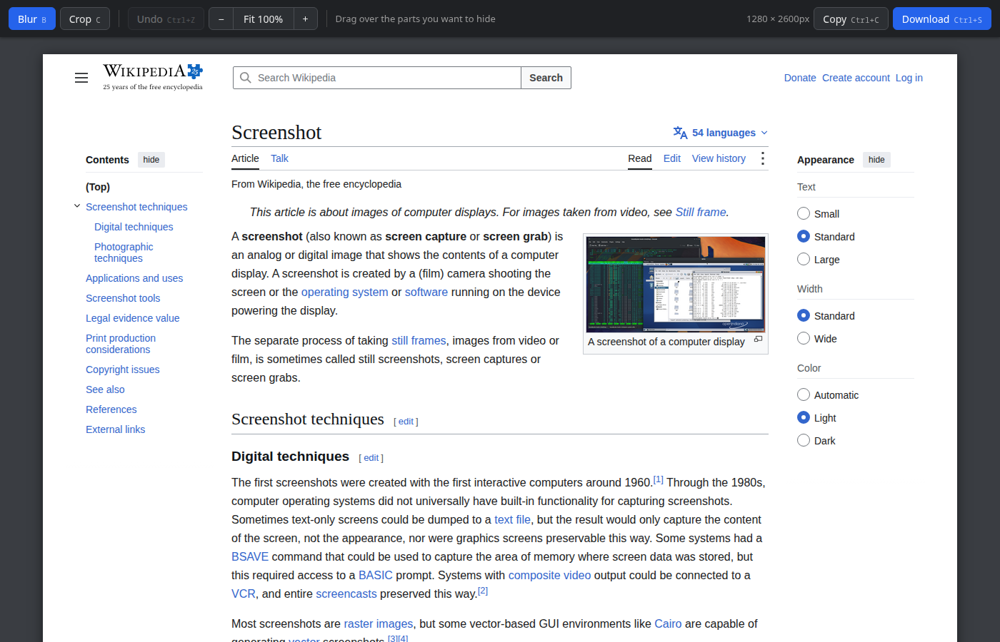

# Full Screenshot

Chrome extension that captures an entire page, top to bottom, including pages
that scroll inside a box and side panels that scroll on their own.

- **Click the icon:** capture, then edit (blur, crop, zoom) and copy or download.
- **Right-click the icon → Quick capture:** copy to clipboard and download right away.



## Features

### Capture

- **Whole page, not just the visible part.** The page is scrolled frame by
  frame and stitched into one PNG at full screen resolution (sharp on HiDPI
  displays). Your scroll position is put back when it finishes.
- **Apps that scroll inside a box.** When the content scrolls in an inner
  container instead of the page (dashboards, web mail, GitLab, Jira and
  similar), that container is detected and captured in full.
- **Side panels that scroll on their own.** Tall drawers and side panels next
  to the main content are scrolled at the same time and stitched into their
  own column, with their header and footer kept in place.
- **No repeated headers.** Fixed and sticky bars are shown once: top bars only
  at the top of the image, bottom bars only at the bottom. Bars that appear only
  after scrolling (like a sticky title bar) are hidden.
- **Clean seams.** Frames overlap and are realigned when the layout shifts
  while scrolling (lazy-loaded images and the like), and the thin border lines
  that bars leave at every seam are trimmed. Scrollbars and smooth scrolling are
  turned off during the capture.
- **Very long pages.** Images that would go over Chrome's canvas limits are
  scaled down to fit instead of failing.
- **Progress on the icon.** The badge shows the capture progress as a
  percentage, or `ERR` if something went wrong.

### Editor

Clicking the icon opens the capture in an editor tab next to the page.

- **Blur:** drag over anything you want to hide. It pixelates the area
  strongly enough that the text underneath can't be recovered.
- **Crop:** drag to select the area to keep, adjust by dragging again, then
  apply.
- **Undo:** up to 30 steps, for both blur and crop.
- **Zoom:** fit to window, 100% (one pixel per page pixel), or step from 10% to
  400%. Ctrl/Cmd + wheel or a trackpad pinch zooms around the pointer.
- **Long screenshots:** the view scrolls automatically while you drag near the
  top or bottom edge.
- **Copy or download:** copy the edited image to the clipboard, or download it
  as `screenshot-<site>-<date>.png`.

#### Keyboard shortcuts

| Key | Action |
| --- | --- |
| `B` | Blur tool |
| `C` | Crop tool |
| `Enter` | Apply crop |
| `Esc` | Cancel selection |
| `Ctrl/Cmd + Z` | Undo |
| `Z` | Toggle fit / 100% |
| `+` / `-` | Zoom in / out |
| `0` | Fit to window |
| `Ctrl/Cmd + C` | Copy to clipboard |
| `Ctrl/Cmd + S` | Download |

### Quick capture

Right-click the icon and choose **Quick capture (copy + download, no editor)**
to skip the editor: the screenshot is copied to the clipboard and saved to your
Downloads folder, and a notification confirms it.

### Privacy

Everything happens locally in your browser. Screenshots are never uploaded
anywhere. The extension only runs on the tab you click it on, and the copy kept
for the editor is deleted after 24 hours.

### Limitations

- Chrome doesn't let extensions capture its own pages. On `chrome://` and
  extension pages the icon does nothing, and on the Chrome Web Store the badge
  shows `ERR`.
- Chrome allows about two captures per second, so long pages take a few
  seconds.
- Content that changes while scrolling (animations, videos, carousels) may not
  line up perfectly.

## Install from a zip

1. Download `full-screenshot-chrome-extension-<version>.zip` from the
   [Releases](https://github.com/ramoncardena/full-screenshot-chrome-extension/releases)
   page, or build it yourself (see below).
2. Unzip it into a folder you will keep (Chrome loads the extension from that
   folder, so don't delete it).
3. Open `chrome://extensions` and turn on **Developer mode** (top right).
4. Click **Load unpacked** and select the unzipped folder.
5. Pin the extension from the puzzle-piece menu in the toolbar.

To update, replace the folder's contents with the new version and click the
reload icon on the extension's card in `chrome://extensions`.

## Install from source

```sh
git clone https://github.com/ramoncardena/full-screenshot-chrome-extension.git
```

Then follow steps 3 to 5 above, selecting the cloned folder.

## Build the zip

```sh
./scripts/package.sh
```

Bump `version` in `manifest.json` before building a new release. The zip in
`dist/` is also what you upload to the Chrome Web Store.

## License

[MIT](LICENSE)
